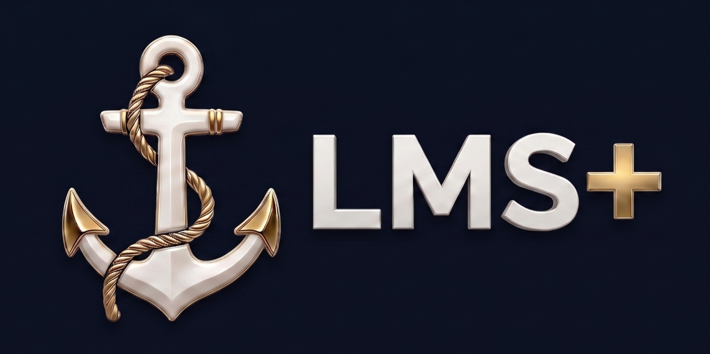

**[LMS+](https://lmsplus.xyz)** is a web wrapper for Bahria University's CMS and LMS. It pulls your key information into a cleaner interface and adds assignment reminders and AI integration via an MCP server.

Your credentials are encrypted and stored securely. Nobody, including me, can view your CMS password. Hundreds of students across Bahria's Karachi, Lahore, and Islamabad campuses use it.

This is an independent project and is not affiliated with Bahria University. I built it because I was tired of constantly getting logged out of CMS, missing assignment deadlines, and checking my attendance every day for mistaken absent marks.

Want to contribute or self-host? Check the [contribution guide](CONTRIBUTING.md) for setup instructions. Please reach out before starting work on a new feature; my socials are listed on the website.

Licensed under the [MIT License](LICENSE).